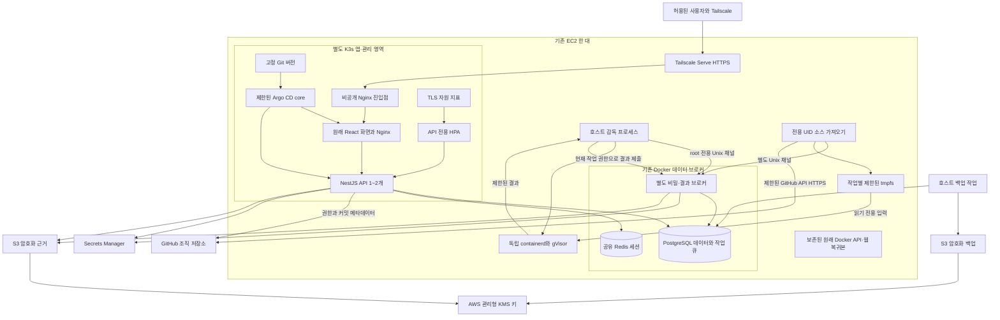
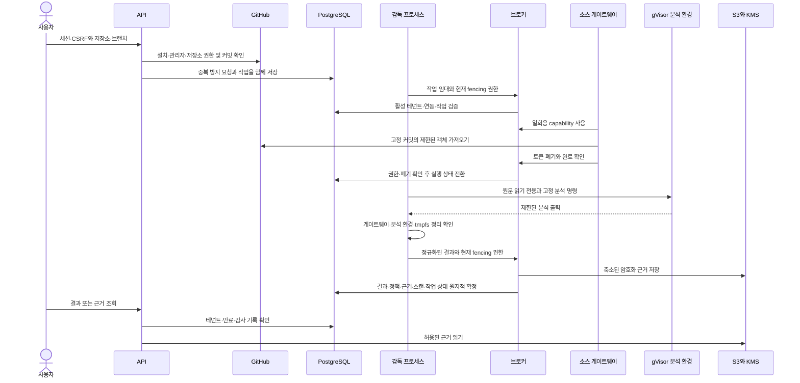

# 현재 배포 아키텍처

현재 배포는 사용자가 승인한 단일 EC2 비공개 운영 범위다. API·웹의 별도 K3s와 독립 스캔용 containerd/gVisor를 사용하지만 호스트 자체는 공유한다. PostgreSQL·Redis·브로커와 원래 Docker API·웹 복귀본은 Kubernetes 밖에 유지한다. 이는 제품 명세의 별도 노드 구성을 충족하는 것으로 간주하지 않는다.

## 구성과 신뢰 경계

Control Plane은 사용자·저장소 메타데이터와 요청을 관리하고 저장소 원문을 다운로드하지 않는다. 별도 소스 게이트웨이가 GitHub 객체를 가져온다. AI Plane은 현재 비활성이고 원문·SCM 비밀 값의 수신자가 아니다. Data/Security Plane은 PostgreSQL, 감사 기록, S3/KMS 및 Secrets Manager로 구현한다.

API와 브로커는 EC2 역할로 필요한 비밀을 읽는다. 게이트웨이는 AWS 메타데이터나 호스트 서비스에 접근할 수 없고, 분석 환경은 네트워크가 없다. 다만 동일 인스턴스 역할이므로 API·브로커 간 독립 IAM 역할 분리나 호스트 침해 격리를 주장하지 않는다.

## 스캔 흐름

작업 전달은 at-least-once다. PostgreSQL 임대와 fencing, 중복 방지 키, 작업별 환경 정리로 오래된 실행의 결과 반영을 차단한다. 메시지 전달 자체가 exactly-once라는 표현은 사용하지 않는다.

## 실행 제한

| 항목 | 현재 설정 | 의미 |
| --- | --- | --- |
| 실제 분석 병렬성 | 1 | 단일 호스트 자원 보호 |
| 큐 임대 | 60초, 15초 heartbeat | 만료·권한 상실 시 기존 결과 반영 차단 |
| 재시도 | 최대 5회, 지수 backoff | 일시 오류만 재시도하고 이후 종료 |
| 테넌트 요청 용량 | 활성·대기 최대 3건 | API의 작업 수용 제한 |
| 큐 라이브러리 임대 용량 | 전체 2, 테넌트 1 | 실제 무거운 분석 2건 실행을 뜻하지 않음 |
| 소스 | 1,000파일, 총 20MiB, 파일당 1MiB | 초과·미지원 입력은 명시적 실패 |
| 소스 가져오기 | 최대 90초 | 고정 Git 객체, 객체 해시 검증 |
| 분석 환경 | CPU 1, 메모리 1GiB, PID 256 | 고정 도구, 비루트, 읽기 전용, 네트워크 없음 |
| capability | 일회용, 최대 10분 | 작업·테넌트·커밋·임대·브로커 epoch에 결합 |
| 취약점 DB | 최대 48시간 신선도, 6시간 갱신 | 오래되면 새 분석 차단, 2개 스냅샷 유지 |
| 근거 | 최대 1MiB, 원문 fragment 0 | 정규화된 규칙·위치 메타데이터만 저장 |

고객 저장소의 빌드·테스트·패키지 설치·스크립트는 실행하지 않는다. GitHub 토큰은 게이트웨이에만 전달하고 분석 전 폐기를 확인한다. capability 10분 제한은 GitHub 토큰 자체의 발급 만료를 단축하는 기능이 아니다. 호스트 전체 장애 때 상류 토큰이 원래 만료까지 남을 수 있는 위험은 [실행 명세](../../specs/003-production-runtime/runtime-execution.md)에 기록돼 있다.

## 데이터와 보관

| 데이터 | 현재 위치와 처리 | 주의점 |
| --- | --- | --- |
| 저장소 원문·원시 도구 출력 | 작업별 tmpfs, 종료 전 정리 확인 | 장기 증거·일반 로그로 저장하지 않음 |
| 발견 항목·도구 실행·정책 | PostgreSQL, 테넌트 조건과 트랜잭션 | 365일 수명주기 자동 정리는 후속 과제 |
| 감사 기록 | PostgreSQL, 토큰 없는 이벤트 | 최소 365일 보관 기준, 독립 불변 감사 저장소는 미구축 |
| 분석 근거 | 비공개 S3, SSE-KMS, 테넌트 문맥 | 7일 만료, 조회 감사, 15분 주기 삭제·재시도 |
| DB 백업 | 암호화 S3, 해시 확인 | 14일 lifecycle, 매일 한국 시각 03:15 이후 지연 가능 |
| 활성 비밀 | Secrets Manager의 Auth·SCM 두 항목 | 메모리 로딩, DB 암호만 부팅 RAM 파일 |
| 기존 복구 사본 | 이전 EBS와 로컬 비활성 파일 | 미암호화 과거 사본·로컬 비밀 사본 예외가 남음 |

S3는 공개 접근을 차단하고 TLS, KMS 암호화 및 신규 객체 조건부 쓰기를 강제한다. Bucket Key를 끄고 객체 ARN 및 별도 테넌트 문맥을 사용한다. 이는 전용 테넌트별 IAM/KMS 키나 S3 Object Lock을 구현했다는 뜻이 아니다.

현재 결과의 coverage는 LIMITED이며 병합 차단은 하지 않는다. 초기 Java 규칙과 선언된 의존성에서 발견 항목이 0개여도 안전한 저장소나 전체 의존성 분석 완료로 표시하지 않는다.

## 배포 방식

현재 private 접속은 서명 소스 3edc8c72a69b의 Kubernetes API·웹으로 처리한다. 기존 Docker 운영 버전은 실제 복귀 대상으로 보존했고 전환·복귀·재전환을 확인했다. 단일 호스트 장애와 무중단을 해결했다고 주장하지 않는다. 화면만 바꿀 때는 API·공유 계약·의존성이 동일한지 먼저 비교한다. 데이터베이스를 되돌리는 대신 접근 차단, 호환성 검토와 forward repair를 우선한다.

제한된 GitOps 동기화·drift 복구·객체 재생성·Git/이미지 복귀와 실제 정상 RollingUpdate·불량 후보 제외/자동 복구를 확인했다. HPA의 실제 API1→2→1, 지표 유실 시 복제 수 유지, Redis 공유 원자적 요청 제한 및 실제 기존 세션/데이터 보존도 통과했다. 현재·직전 승인 이미지 쌍은 CRI 삭제 방지 상태로 보존한다. 별도 active/preview Service와 제한된 Rollouts로 실제 API Blue/Green 전환·복귀도 확인했다. 정상 Deployment 경로와 HPA1~2로 복원했고 검증 profile은0개로 보존한다. Canary, 깊은 큐/브로커/스캐너 추적과 전체 IaC/CD 재현은 남아 있다. [최신 운영 기록](./2026-11-10-rollout-scaling-checkpoint.md)과 [남은 작업](./remaining-work.md)을 따른다.

최신 선택자/종료 유예와 Blue/Green 운영 근거는 [11월10일 후속 기록](./2026-11-10-blue-green-checkpoint.md)을 따른다.
